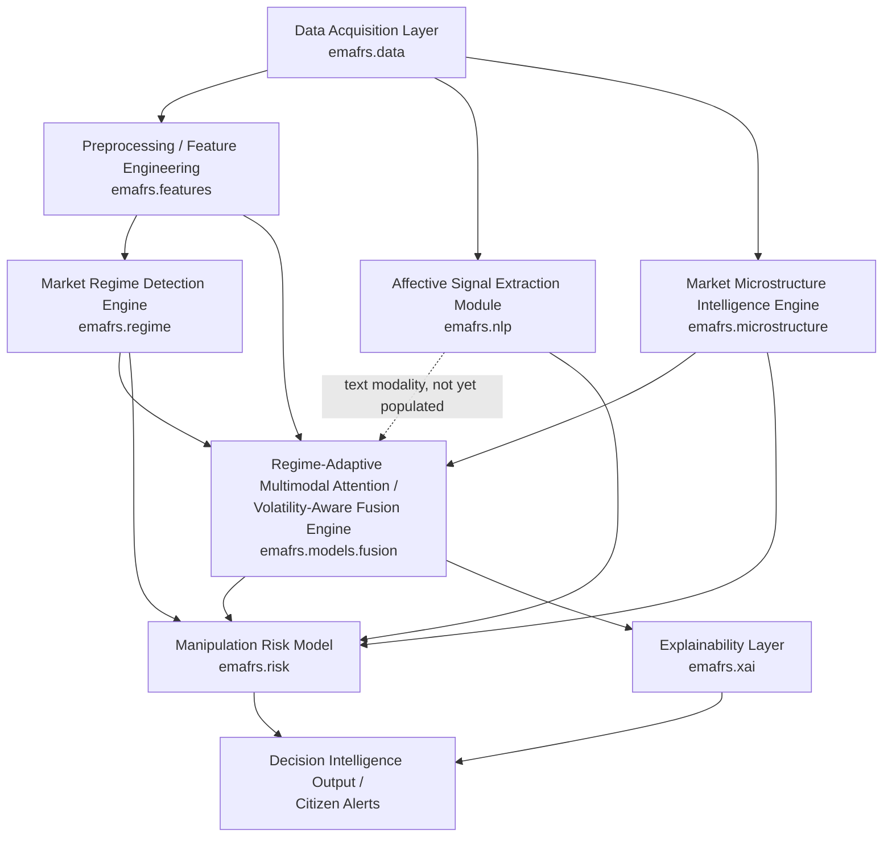
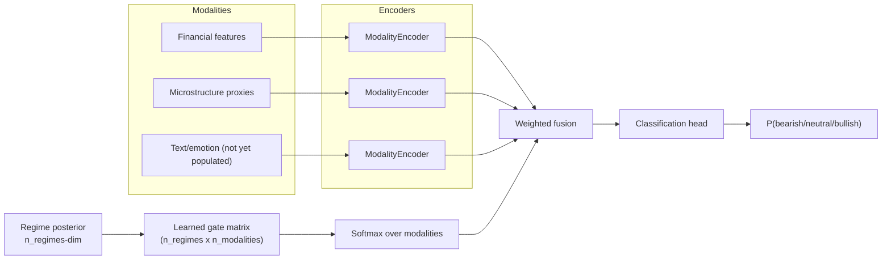

# System Architecture

Reconstructs the PDF's modular pipeline (Section 6.1, Figures 1-4) as a real, tested
Python package (`src/emafrs/`). Modularity is deliberate and preserved: each layer below
is a separate package with its own tests, not collapsed into one end-to-end model.

## Pipeline overview

## RAMA mechanism (the core inventive mechanism, PDF Summary "First Inventive Mechanism")

Note: this is the DISCLOSED-corrected version of the PDF's RAMA formula — see
`docs/PDF_TO_IMPLEMENTATION_TRACEABILITY.md` row #19 and `src/emafrs/models/fusion.py`
docstring for why the literal patent formula could not be implemented as printed.

## Module map

| PDF concept | Package | Key files |
|---|---|---|
| Data Acquisition Layer | `emafrs.data` | `yfinance_client.py`, `alphavantage_client.py`, `finnhub_client.py`, `newsapi_client.py`, `youtube_client.py`, `fred_client.py`, `sec_edgar_client.py`, `health.py` |
| Preprocessing / Feature Engineering | `emafrs.features` | `technical.py`, `preprocessing.py`, `risk_metrics.py`, `leakage_audit.py` |
| Affective Signal Extraction Module (ASEM) | `emafrs.nlp` | `sentiment.py`, `emotion.py`, `semantic_encoder.py`, `roles.py`, `credibility.py`, `hype.py`, `asem.py`, `sentiment_benchmark.py` |
| Market Regime Detection Engine (MRDE) | `emafrs.regime` | `info_dynamics.py` (Hurst/entropy), `hmm_regime.py`, `evaluation.py` |
| Market Microstructure Intelligence Engine (MMIE) | `emafrs.microstructure` | `proxies.py` |
| Volatility-Aware Adaptive Fusion Engine / RAMA | `emafrs.models` | `dataset.py`, `labels.py`, `baselines.py`, `fusion.py`, `train.py`, `calibration.py` |
| Manipulation risk model, cross-modal conflict | `emafrs.risk` | `manipulation_risk.py`, `cross_modal_conflict.py` |
| Explainability layer | `emafrs.xai` | `integrated_gradients.py`, `counterfactual.py`, `nlg.py`, `evaluation.py` |
| Experiment protocol | `emafrs.experiments` | `walk_forward.py`, `significance.py` |
| Helper dev tooling (not a research claim) | `emafrs.mcp_server` | `tools_data.py`, `tools_inspect.py`, `server.py` |

## Data flow and provenance

Every record produced by `emafrs.data` carries `(provider, endpoint, fetched_at,
observation_time, license_note, cache_hit)` (`emafrs.data.schema.SourceRecord`) so nothing
downstream can lose track of where a number came from or how fresh it is. See
`docs/DATA_SOURCES_AND_APIS.md`.

## What is NOT collapsed into a single model

The build brief explicitly warns against collapsing the architecture into one generic
neural network. Concretely, in this implementation:
- Regime detection (`fit_regime_hmm`) is a **separate, inspectable HMM**, not a hidden
  layer inside the fusion network — its transition matrix, per-regime feature means, and
  quality report (persistence, separation) are all directly queryable.
- The manipulation risk score is a **separate, disclosed weighted combination**
  (`compute_manipulation_risk`) over the fusion model's inputs, not a learned head buried
  inside the neural network — its weights are inspectable and, by default, an equal-weight
  prior rather than an opaque fit.
- The explainability layer operates on the **already-trained, frozen** fusion model —
  it is a genuinely separate analysis step (Integrated Gradients, counterfactual search),
  not something the model optimizes for during training.

## Production architecture (planned, not yet built)

FastAPI backend + persistent DB + dashboard + Docker are tracked separately — see
`docs/PRODUCTION_DEPLOYMENT.md` and `docs/MLOPS.md` once that phase lands. This document
describes the research/modeling architecture that exists today.
